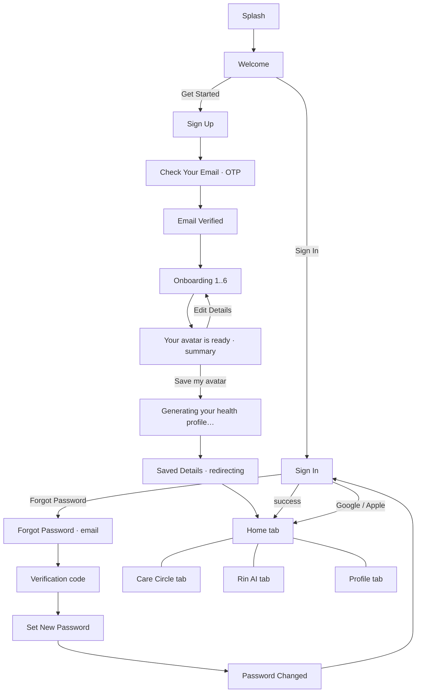

# 01 — Product Overview

## 1. What NaraaCare is

NaraaCare is a mobile health-tracking app built around **avatars that change as the user meets daily goals** for 💧 Hydration, 🍽 Nutrition (the "Energy Avatar") and 😴 Sleep. Users share avatars in **Care Circles**, chat with **Rin AI**, keep a **streak**, and download **reports**.
Tagline (FIG Welcome): *"Glow when you're well. Know when they're not."*

Platforms: **Android + iOS only** (iPhone frame 390×844, Android frame 412×917).
Audience: adults **18+** in India (OQ-34, OQ-54). English first, ready for Hindi.

## 2. User roles

| Role | Who | Capabilities | Source |
|---|---|---|---|
| `user` | App user (STANDARD or STAR) | Own data only; shares chosen avatars with circles | DOC |
| `circle_admin` (circle-scoped) | Circle creator / promoted member | Manage members, circle name/wallpaper, invite links, delete messages | DOC §5, FIG |
| `nutritionist` | Internal staff | Maintain the food DB | DOC §4b (implied), OQ-42 |
| `support` | Internal staff | Read support tickets; no access to health logs | FIG Help & Support |
| `admin` | Internal staff | Reference data, feature flags; no routine access to health data | — |

Staff roles use the same auth system with role claims. All staff endpoints are under `/api/v1/admin/*`, are IP-allow-listed, and every staff action is written to `audit.change_log`.

## 3. Feature list

| # | Area | Feature | Source |
|---|---|---|---|
| F1 | Auth | Email + password sign-up with 6-digit email OTP; Google / Apple sign-in; forgot/reset password via OTP; stays signed in until logout; log out of all devices | DOC §2, FIG |
| F2 | Onboarding | 6 steps: sex + avatar + name · height (cm/ft-in) · weight (kg/lb) + goal · target weight + medical conditions · age + activity level · body type → result summary → "Save my avatar" → generating profile → Home. Resumable. | DOC §3, FIG |
| F3 | Home | Greeting (Good Morning/Afternoon/Evening, name) + 3 avatars in a carousel; each has Share, Info, and an edit window of the last 2 entries | DOC §4, FIG |
| F4 | Hydration avatar | Swipe ±100 mL; add water (presets +1 sip, +250, +500, +750 mL); other drinks with hydration factors; STAR: temperature, workouts, custom drinks via AI; avatar states (0 %, in progress, goal completed, above goal, day ending soon, temperature nudge) | DOC §4a + Hydration Logic, FIG |
| F5 | Nutrition avatar | Food search → quantity + Indian unit (katori, piece…) → add items → Save Meal → Nutrition Summary → Update Meal; Recent & Saved meals; Today's Nutrition (6 or 17 nutrients); STAR: voice and barcode logging, meal-by-meal breakdown | DOC §4b + Nutrition spec, FIG |
| F6 | Sleep avatar (STAR) | Sleep and wake time, night wakings, multiple entries per day; duration, goal, score; blurred upsell for STANDARD | DOC §4c, FIG |
| F7 | Care Circle | Username required; create circle; add by username or invite link; invites (Accept / Decline / Maybe Later); choose ≥ 1 avatar to share; chat with @mentions; Recent Updates feed; members; circle settings, notifications, wallpaper, leave | DOC §5, FIG |
| F8 | Rin AI (STAR) | AI health chat; suggested prompts; meal logging by chat (Add to Avatar / Edit / Not Now); drink water estimate; search conversations; delete chat; help + disclaimer; token allowance | DOC §6, FIG |
| F9 | Profile | Full-body avatar; Connections (my connections, find people, requests, block); Active Streak (current, longest, calendar, broken state); Care Circles count; Download Report; personal notifications | DOC §7, FIG |
| F10 | Settings | Edit Profile; Username; Account (email, password, delete account); Notifications & Reminders; My Subscriptions; Refer a Friend; Terms / Privacy / Licenses; Help & Support (FAQs, contact, report a problem, request a feature, guide); Log Out | DOC §8, FIG |
| F11 | Subscriptions | STAR monthly/yearly via store billing; cancel anytime (access to period end); billing history | DOC §8, OQ-06/07 |
| F12 | Referral | Unique code + link; 5 friends active for 30 days → 30 days STAR (STANDARD) / 50 days STAR (STAR) | DOC §9, FIG |
| F13 | Notifications & reminders | Push + in-app list; per-category toggles; hydration/nutrition/sleep reminders; daily check-in | DOC §7–8, FIG |
| F14 | Privacy | Granular consent; data export; account deletion with 30-day grace; medical disclaimers | Brief §7, OQ-47 |

## 4. STANDARD vs STAR matrix

"Server" means the backend enforces it. The app also hides or upsells, but that is never the only control.

| Capability | STANDARD (free) | STAR (₹199/mo or ₹1,899/yr — OQ-06) | Enforced by |
|---|---|---|---|
| Hydration: water logging, swipe ±100 mL | ✅ | ✅ | — |
| Hydration drinks | Water, tea, milk, coconut water | + coffee, juice, beer (0 %), custom drinks with AI water estimate | Server (`ref.drink_type.tier_required`) |
| Hydration goal | Profile-based at 25 °C, no workouts | + temperature scaling, workout sweat (Advanced Dynamic Hydration) | Server (OQ-04) |
| Nutrition logging method | Text search | + voice, barcode | Server (endpoints 403 `UPGRADE_REQUIRED`) |
| Meal logs per day | 4 | 8 | Server (procedure counts) |
| Nutrients shown | 6: Calories, Protein, Carbohydrates, Fat, Dietary Fiber, Total Sugar | 17: + Saturated, Polyunsaturated, Monounsaturated, Trans fat, Cholesterol, Sodium, Potassium, Calcium, Iron, Vitamin A, Vitamin C | Server (response filtered by tier) |
| Meal-by-meal macro breakdown | ❌ | ✅ | Server |
| Custom goal profiles (Keto, High Protein) | ❌ | Post-MVP (OQ-11) | — |
| Sleep avatar | Locked / blurred + upsell | ✅ | Server |
| Share Sleep avatar in circles | ❌ | ✅ (visible only to STAR members) | Server |
| Rin AI | Upsell screen | ✅ (daily token allowance — OQ-37) | Server |
| Reports | Monthly; Hydration + Nutrition | Custom date range; + Sleep + AI insights | Server |
| Referral reward | 30 days STAR | 50 days STAR | Server |
| Care Circles | ✅ unlimited circles, ≤ 50 members each | ✅ | Server |
| Support | Ticket | Priority (FIG) | Process |

## 5. Primary user flows

Resume rule: if the user quits during onboarding, the next launch resumes at the saved step (DOC §2.4).

## 6. Out of scope for MVP (explicit)

- Wearable / Health Connect / HealthKit sync (DOC mentions device sensors as future).
- Custom goal profiles (Keto etc.), AI sleep goal (OQ-11, OQ-23).
- Location-based weather; temperature is manual (OQ-19).
- Custom card/UPI checkout (OQ-07).
- Web app, tablet layouts, Android Wear / watchOS.
- Rich text anywhere (would need separate approval + `nh3` sanitising).
- Avatar customisation shop ("Avatar updates (Later)" in FIG notification settings).

## 7. Disclaimers (must appear in app)

- Hydration Info, Nutrition Info, Sleep Info, Rin AI help, and every report: *"NaraaCare provides general wellness estimates for healthy adults and is not a medical device or medical advice. People who are pregnant, have kidney or heart conditions, or take medicines that affect fluids or diet should follow their doctor's advice."* (DOC Hydration Logic footnote, DOC §6, §10)
- Temperature note: *"The temperature you enter stays in use until you change it and affects your goal."* (DOC §4a)
- Rin AI: *"Rin AI is a support tool, not a substitute for professional medical advice."* (FIG)
