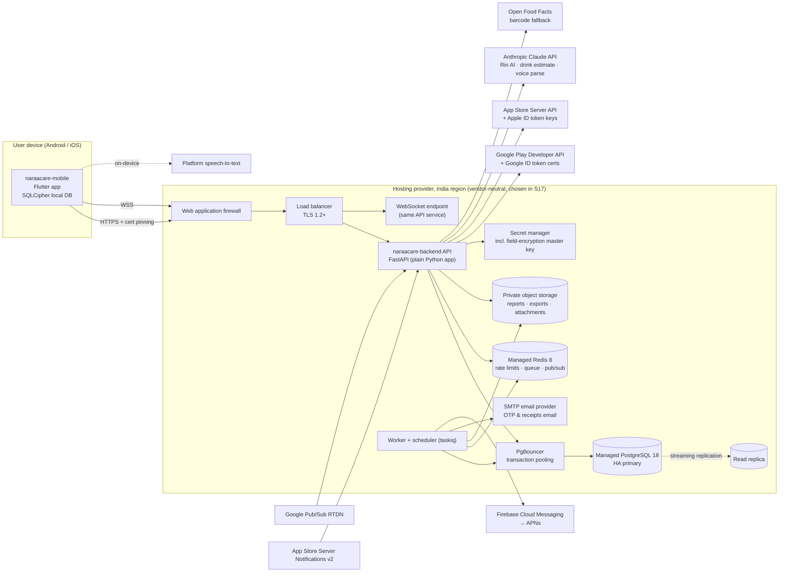
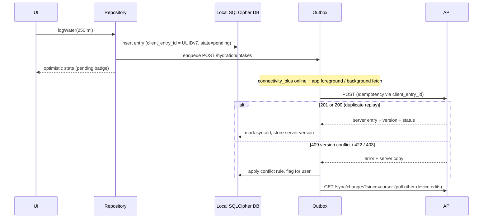

# 03 — System Architecture

## 1. Context



Data residency: all NaraaCare data stores live in one Indian region (whichever provider is chosen). Outbound transfers (Claude API, FCM, Sentry, Open Food Facts) send the minimum needed; they are listed in the privacy notice (doc 07 §9).

## 2. Pinned versions

| Layer | Component | Version | Why |
|---|---|---|---|
| Mobile | Flutter / Dart | **3.47.7 / 3.13.5** (stable, 2026-10-08) | latest stable on dev machine |
| Mobile | flutter_riverpod / riverpod_annotation | 3.4.3 / 4.0.7 | state + DI |
| Mobile | go_router | 18.1.1 | declarative routing, redirects |
| Mobile | dio | 5.11.1 | HTTP, interceptors, cert validation hook |
| Mobile | drift / drift_dev / build_runner | 2.35.3 / 2.35.2 / 2.16.2 | offline DB, typed queries (codegen checked in CI) |
| Mobile | sqlite3 (build hook `source: sqlcipher`) | 3.8.0 | SQLCipher compiled in; `sqlcipher_flutter_libs` is end-of-life, so it is not used. The app refuses to open the DB if `PRAGMA cipher_version` is empty |
| Mobile | connectivity_plus | 7.3.2 | online/offline stream (banner, outbox) |
| Mobile | unorm_dart / uuid / crypto | 0.3.3 / 4.6.0 / 3.0.8 | NFKC (validator parity with the API), UUIDv7 ids, SPKI SHA-256 |
| Mobile | path_provider / path | 2.1.6 / 1.9.1 | DB file location |
| Mobile | flutter_secure_storage | 11.2.0 | Keychain / Keystore |
| Mobile | freezed / json_serializable | 4.0.3 / 6.15.2 | immutable models |
| Mobile | in_app_purchase | 3.3.1 | Play Billing + StoreKit |
| Mobile | google_sign_in / sign_in_with_apple | 7.2.0 / 8.2.0 | social login |
| Mobile | local_auth | 3.0.2 | biometric app lock |
| Mobile | firebase_messaging / flutter_local_notifications | 17.0.1 / 22.3.3 | push + local reminders |
| Mobile | mobile_scanner / speech_to_text | 7.4.2 / 7.5.0 | barcode, STT |
| Mobile | app_links | 7.2.2 | deep links (invites, referral) |
| Mobile | url_launcher | 6.3.3 | legal documents open in the external browser (no WebView) |
| Mobile | screen_protector / flutter_jailbreak_detection | 1.5.3 / 1.10.0 | screenshot block, root warn |
| Mobile | sentry_flutter | 10.2.0 | crash reporting (scrubbed) |
| Mobile | very_good_analysis / mocktail / patrol | 11.0.0 / 1.0.5 / 4.10.0 | lint, mocks, E2E |
| Backend | Python | **3.13.17** (installed by uv) | mature wheels for all deps (3.14 viable later) |
| Backend | FastAPI / uvicorn | 0.162.0 / 0.54.0 | API |
| Backend | Pydantic / pydantic-settings | 2.14.1 / 2.16.1 | validation, config |
| Backend | SQLAlchemy (async core, no ORM models) / asyncpg | 2.1.6 / 0.32.0 | pooled async calls to functions/procedures |
| Backend | argon2-cffi / PyJWT / cryptography | 25.1.0 / 2.15.1 / 50.0.2 | hashing, tokens (EdDSA access tokens; Google/Apple ID tokens verified with PyJWT instead of google-auth, S05), AES-GCM |
| Backend | redis / taskiq / taskiq-redis | 8.1.0 / 0.13.0 / 1.2.4 | cache, rate limit, job queue + scheduler (arq was dropped: it caps redis-py < 6) |
| Backend | structlog / httpx2 | 26.1.0 / 2.16.0 | JSON logs, outbound HTTP (provider JWKS, Apple token endpoint; runtime dependency since S05). httpx2 = maintained successor of httpx; Starlette's TestClient requires it |
| Backend | nh3 | 0.3.7 | only if rich text is ever approved |
| Backend | regex / email-validator / tzdata | 2026.9.29 / 2.3.0 / 2026.6 | Safe* validators: Unicode properties (Indic scripts), email syntax, IANA zones on every OS (added S04) |
| Backend (dev) | fakeredis / pytest-asyncio / types-regex | 2.40.0 / 1.4.1 / 2026.9.29.20261017 | in-memory Redis for limiter tests, async tests, stubs (added S04) |
| Backend | anthropic | 2.3.0 | LLM (S09: drink estimate). FCM uses the HTTP v1 API directly (httpx2 + PyJWT) instead of firebase-admin, for a smaller dependency surface. Object storage SDK: the chosen provider's, pinned in S17 |
| Backend | (none) | — | receipt verification: S11 calls the Play Developer API and App Store Server API over HTTPS and verifies Apple JWS chains with `cryptography`, instead of google-api-python-client / google-auth / app-store-server-library (smaller dependency surface; same checks) |
| Backend | reportlab | 5.1.0 | PDF reports (no HTML → no HTML injection) |
| Backend | pytest / ruff / mypy / bandit / pip-audit / semgrep | 9.1.1 / 0.17.2 / 2.4.0 / 1.9.4 / 2.10.1 / 1.182.1 | quality + security |
| DB | PostgreSQL | **18.6** (native install locally; managed PostgreSQL 18.x in staging/prod) | native `uuidv7()`, async I/O; ≥16 requirement met |
| DB | Flyway | **13.11.1** (CLI; sha256-verified download in CI) | native `V001__` naming, repeatable `R__` |
| Dev | Local storage / email | filesystem folder (`var/storage/`), outbox folder of `.eml` files (`var/outbox/`) | no emulators or containers to run; the interfaces are the same as in prod |
| Dev/CI | uv | 0.13.6 | Python toolchain + lockfile |
| DB | pgTAP | 1.3.4 | DB unit tests |
| DB | sqlfluff | 4.4.0 | SQL lint |
| Infra | Redis | 8.8.3 (native install locally; managed Redis 8.x in staging/prod) | |
| Infra | PgBouncer | 1.26.1 (staging/prod only; locally the API connects to PostgreSQL directly) | transaction pooling |
| CI | gitleaks | 8.30.1 | secret scanning |

Upgrades are proposed by Dependabot/Renovate PRs; never floating versions.

## 3. Mobile architecture (`naraacare-mobile`)

**State management: Riverpod 3 (with code generation).** Why: compile-time-safe DI without `BuildContext`, easy overriding in tests, first-class async (`AsyncValue`) for network + offline states, and less boilerplate than Bloc for ~60 screens. Bloc's event traceability is not needed; the `ProviderObserver` gives logging.

```
lib/
  core/
    config/        app_config.dart (reads --dart-define-from-file), flavor.dart
    theme/         tokens.dart (from Figma), app_theme.dart, typography.dart
    routing/       app_router.dart (go_router), guards (auth, onboarding, tier)
    network/       dio_client.dart, interceptors/ (auth_refresh, request_id, retry, error_mapper), pinning.dart
    errors/        failure.dart, api_error.dart
    security/      input_validators.dart, secure_storage.dart, root_check.dart, screen_guard.dart, deep_link_validator.dart
    storage/       app_database.dart (drift + SQLCipher), outbox/ (sync queue)
    sync/          sync_engine.dart, conflict_resolver.dart
    l10n/          arb files (en, hi stub)
    utils/         units.dart (cm↔ft, kg↔lb, °C↔°F), clock.dart
  features/
    auth/ onboarding/ home/ hydration/ nutrition/ sleep/ care_circle/ connections/
    rin_ai/ profile/ streak/ reports/ notifications/ settings/ subscriptions/ referral/ support/ privacy/
      data/ (dto, remote_data_source, local_data_source, repository_impl)
      domain/ (entities, repository contract, use_cases)
      presentation/ (screens, widgets, providers)
  shared/ widgets/ (buttons, text fields, avatar card, chips, sheets), design tokens re-export
  main_dev.dart main_staging.dart main_prod.dart
```

Rules: presentation → domain → data only; features don't import other features' data layers (shared contracts go to `shared/` or `core/`). No business calculation in the app: the app renders server numbers (`avatar_fill_percentage`, `level_pct`, goals). The only local maths is unit conversion and optimistic display (doc 06 §10).

### 3.1 Offline-first logging and sync



Conflict rules: creates are idempotent by `client_entry_id`. Updates/deletes carry `If-Match: <version>`. On a 409 the **server copy wins** and the user sees "This entry was changed on another device". Edits outside the "last 2 entries" window are rejected by the server and rolled back locally. Entries older than 7 days are not accepted (OQ-53).

## 4. Backend architecture (`naraacare-backend`)

```
app/
  main.py                    app factory, middleware order, router mounting
  api/v1/routers/            auth.py me.py reference.py foods.py meals.py nutrition.py hydration.py workouts.py
                             sleep.py streak.py people.py connections.py circles.py chat.py realtime.py rin.py
                             notifications.py devices.py reports.py billing.py billing_webhooks.py referrals.py
                             privacy.py support.py admin_foods.py health.py sync.py
  core/
    config.py                pydantic-settings (fail fast)
    logging.py               structlog JSON, PII redaction processor
    exceptions.py            AppError hierarchy → uniform error envelope
    security/
      validators.py          Safe* types (single source of input rules)
      hashing.py             Argon2id
      tokens.py              JWT access + refresh rotation
      crypto.py              AES-256-GCM envelope encryption (data keys wrapped by a master key), blind index HMAC
      authz.py               current_user, require_role, require_entitlement(feature)
  domain/
    nutrition/ calculator.py (BMR→avatar), portions.py, voice_parser.py
    hydration/ calculator.py (Yamada model, tank), status.py
    sleep/ calculator.py
    streak/ referral/ entitlements/ reports/ ai/ (prompting, guardrails, metering)
  repositories/              one module per schema; ONLY calls DB functions/procedures with bound params
  schemas/                   Pydantic request/response models (every str is a Safe* type)
  middleware/                request_id.py security_headers.py body_size_limit.py rate_limit.py access_log.py
  integrations/              google_play.py app_store.py fcm.py email.py (smtp/outbox) anthropic_client.py storage.py (filesystem/provider) open_food_facts.py
  workers/                   broker.py (taskiq broker + scheduler), jobs/: reminders, partitions, purge, reports, exports,
                             deletions, referral_tally, streak_rollover, subscription_reconcile
tests/ unit/ integration/ security/ (payloads/) contract/ performance/
```

Request pipeline (outer → inner): `RequestID → AccessLog → SecurityHeaders → BodySizeLimit (1 MB; 10 MB only on support upload) → CORS (allow-list; mobile has no Origin) → RateLimit (Redis) → Router → Auth dependency (JWT) → Entitlement dependency → Pydantic validation (Safe*) → Domain → Repository (SET LOCAL app.user_id; SELECT fn(...))`.

Why stored functions/procedures: least privilege (the app role cannot touch tables), validation and invariants live next to the data, and SQL injection becomes impossible from the API (only bound parameters to fixed function names). The trade-off is more SQL to maintain; pgTAP tests cover it.

## 5. Database architecture (`naraacare-database`)

Schemas: `auth, app, ref, activity, nutrition, hydration, sleep, social, ai, billing, notify, privacy, support, report, audit, ops`. Details in doc 05.
Access path: `app_rw` → `EXECUTE` on functions/procedures (owned by `api_definer`, `SECURITY DEFINER`, fixed `search_path`) → tables with Row-Level Security keyed on `current_setting('app.user_id')`.

## 6. Key data flows

### 6.1 Log a meal (DOC Nutrition data flow, hardened)

```mermaid
sequenceDiagram
  participant App
  participant API
  participant Dom as domain.nutrition
  participant DB
  App->>API: POST /meals {client_entry_id, logged_at, meal_type, items[{food_id, quantity, unit_code, unit_size}]}
  Note right of API: user_id comes from the JWT, never from the body (fixes DOC sample payload)
  API->>API: Safe* validation, entitlement (source=voice/barcode needs STAR)
  API->>DB: SELECT nutrition.fn_food_portions(food_ids)
  API->>Dom: grams = qty × grams_per_unit; nutrients = per100 × grams/100 (17 fields)
  API->>DB: CALL nutrition.pr_log_meal(user, payload, limit) — locks the user-day row, checks limit 4/8,<br/>inserts meal + items (snapshot), upserts daily_summary, marks activity day, writes feed event
  DB-->>API: meal_id, version, day totals
  API-->>App: 201 {meal, daily_summary (tier-filtered), avatar: {fill_pct, state}}
```

### 6.2 Hydration status

`GET /hydration/status` → the repository loads the profile snapshot, today's temperature changes, intakes, workouts and meal credits → `domain.hydration.status(at=now)` integrates drain piecewise (sleep/awake rates, temperature changes) → returns level %, band, balance, goal, consumed, left to drink, state. It is computed on read (cheap: < 200 rows/day), so the server stays the single source of truth.

### 6.3 Subscription purchase

App buys via store SDK → `POST /billing/purchases/verify` → backend verifies with Google Play Developer API (`purchases.subscriptionsv2.get`) or App Store Server API (signed transaction JWS verified with Apple root certs) → `billing.pr_upsert_subscription` → entitlement recomputed → the app refreshes `/me/entitlements`. Store server notifications (RTDN via Pub/Sub push with OIDC JWT, ASSN v2 JWS) keep the status current. The app's local purchase state is never trusted.

### 6.4 Realtime chat

`POST /realtime/ticket` (JWT) → 30-second single-use ticket → `WSS /api/v1/ws?ticket=` → the server subscribes the socket to Redis channels for the user's circles. `POST /circles/{id}/messages` persists via procedure, then publishes to `circle:{id}`. Offline members get FCM push (mentions only, by default).

### 6.5 Rin AI

`POST /rin/conversations/{id}/messages` → Safe validation → allowance check (Redis + `ai.usage_event`) → build context (own profile summary + last 7 days aggregates, no other users' data) → Claude API streaming → SSE to the app → content encrypted at rest → usage recorded → meal-log tool output becomes an `ai.pending_action` that the user accepts or dismisses.

## 7. Cross-cutting

| Concern | Approach |
|---|---|
| Config | env vars per environment; pydantic-settings fail-fast; prod values from the hosting provider's secret manager, injected as environment variables at start |
| Observability | structlog JSON to stdout → the provider's log service; OpenTelemetry metrics + traces over OTLP (request_id = trace correlation); Sentry errors; database metrics + `pg_stat_statements`; dashboards + alerts (doc 11) |
| Time | All timestamps `timestamptz` UTC; `local_date` computed server-side from the user's timezone at write time |
| Idempotency | `client_entry_id` (creates), `Idempotency-Key` header for purchase verify / report create, unique `notification_id` for store webhooks |
| Feature flags | `ref.feature_flag` (server) + `FEATURE_FLAGS` dart-define for UI-only toggles |
| i18n | ARB files; server returns message **codes** + params; app localises |
