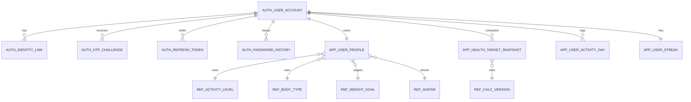
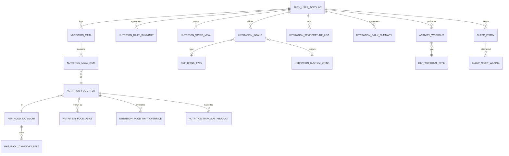
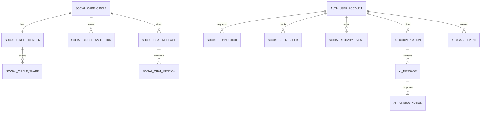
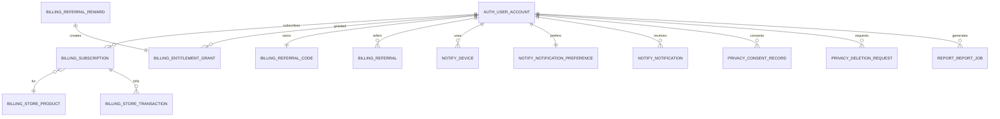

# 05 — Database Design (`naraacare-database`, PostgreSQL 18.6)

## 1. Principles

> **2026-11-03 (owner decision):** user data is stored in plain text for debugging. Only passwords (Argon2id) and secret tokens (refresh tokens, invite-link tokens: SHA-256) are hashed. Wherever this document mentions `_ct` ciphertext or `_bidx` blind-index columns, read them as plain columns with a validating domain (doc 07 §6.1, OQ-74).

| Principle | Decision | Why |
|---|---|---|
| Normal form | 3NF. Denormalised exceptions listed in §8 | integrity; exceptions only for read-hot aggregates |
| Primary keys | `uuid DEFAULT uuidv7()` (PG 18 native) for business rows; `bigint GENERATED ALWAYS AS IDENTITY` for audit/security logs and small reference tables | UUIDv7 is time-ordered, so inserts append to the right of the B-tree like an identity, but IDs are safe to expose and can be generated offline on the device (`client_entry_id`) |
| "Clustered" equivalent | PostgreSQL has no persistent clustered index. (1) Ordered PKs (UUIDv7/identity) keep heap and index insert-ordered. (2) High-volume time-series tables use **declarative monthly RANGE partitioning** on their time column (preferred over `CLUSTER`, which locks and decays). (3) `CLUSTER … USING` is used only on `ref`/`nutrition.food_item` after bulk loads | partition pruning + cheap retention (`DETACH`/`DROP`) |
| Audit columns | Every business table: `created_at timestamptz NOT NULL DEFAULT now()`, `updated_at timestamptz NOT NULL DEFAULT now()`, `created_by uuid`, `updated_by uuid`, `deleted_at timestamptz` (soft delete). Abbreviated below as **`+STD`** | DOC/brief requirement; `updated_at` via trigger; actor from `current_setting('app.user_id')` |
| Soft delete | All user-content tables. Partial indexes `WHERE deleted_at IS NULL` | edit/delete history + sync tombstones; hard purge by retention job |
| Time | `timestamptz` (UTC). `local_date date` stored at write time from the user's timezone | day bucketing must not change if the timezone later changes (OQ-40) |
| Units | Metric only (cm, kg, mL, °C, kcal, g/mg/mcg per `ref.nutrient.unit`) | DOC §3 "store metric internally" |
| Text safety | Domains in schema `common` reject markup; every text column has a length CHECK | Layer 3 of input validation (doc 07 §4) |
| Access | No table privileges for the app. Only `EXECUTE` on functions/procedures | least privilege, injection-proof surface |
| Sensitive fields | Application-level AES-256-GCM (envelope encryption: data keys wrapped by a master key in the secret manager); stored as `bytea` `*_ct` columns + HMAC blind index where lookup is needed | DPDP; DB/backup leak does not expose PII |

## 2. Schemas

| Schema | Contents |
|---|---|
| `common` | domains, shared trigger functions (`set_updated_at`, `audit_row`) |
| `auth` | accounts, identities, OTP, refresh tokens, password history, login attempts |
| `app` | user profile, health target snapshots, activity days, streaks |
| `ref` | reference data: calc versions/constants, activity levels, body types, goals, drinks, workouts, nutrients, units/portions, medical conditions, avatars, tiers/features, policies, feature flags |
| `activity` | workouts |
| `nutrition` | food DB, aliases, barcodes, meals, meal items, saved meals, daily summary |
| `hydration` | intakes, custom drinks, temperature log, daily summary |
| `sleep` | sleep entries, night wakings, daily summary |
| `social` | connections, blocks, circles, members, shares, invite links, chat, mentions, activity events |
| `ai` | Rin conversations, messages, memory summaries, pending actions, usage events |
| `billing` | store products, subscriptions, transactions, store notifications, entitlement grants, referral codes, referrals, rewards |
| `notify` | devices, preferences, reminders, notifications |
| `privacy` | consent records, export requests, deletion requests, retention policy |
| `support` | tickets, feature requests |
| `report` | report jobs, reporting views (aggregated, pseudonymised) |
| `audit` | change log, security events |
| `ops` | partition config, maintenance procedures |

## 3. ER diagrams

### 3.1 Identity, profile, reference



### 3.2 Tracking



### 3.3 Social and AI



### 3.4 Billing, notifications, privacy



## 4. Domains (schema `common`)

```sql
-- No markup / scripting. Defence in depth: the API allow-list is authoritative.
CREATE DOMAIN common.safe_text AS text
  CHECK (VALUE !~ '[<>]'
     AND VALUE !~ '[\x01-\x08\x0B\x0C\x0E-\x1F\x7F]'
     AND VALUE !~* '(javascript|vbscript|data)\s*:'
     AND VALUE !~* '(^|[^a-z])on[a-z]+\s*='
     AND VALUE !~ '(\{\{|\$\{|<%|%>)'
     AND VALUE !~* '&#|%3c|%3e|\\u003c|\\x3c');
CREATE DOMAIN common.username   AS text CHECK (VALUE ~ '^[a-z0-9](?:[a-z0-9._]{1,28})[a-z0-9]$' AND VALUE !~ '[._]{2}');
CREATE DOMAIN common.blind_index AS bytea CHECK (octet_length(VALUE) = 32);
CREATE DOMAIN common.ciphertext AS bytea CHECK (octet_length(VALUE) BETWEEN 29 AND 65536); -- 12B nonce + ≥1B + 16B tag
-- As built in S02 (schemas/020_domains.sql) there are more domains, so that NO column uses bare text:
--   common.code (codes/enums), common.username, common.argon2_hash, common.iana_timezone, common.locale,
--   common.app_version, common.version_label, common.opaque_ref, common.https_url, common.deep_link,
--   common.object_key, common.asset_key, common.barcode, common.referral_code, common.currency, common.sha256_hex.
-- tests/060 fails if any table column is plain text/varchar, or a safe_text column lacks a length CHECK.
```
(Null bytes cannot be stored in `text` at all; PostgreSQL rejects `\x00`.)

Text columns below are `common.safe_text` plus `CHECK (char_length(col) BETWEEN 1 AND n)`, written **`safe_text(n)`**.

## 5. Tables

Notation: **PK**, **FK→**, **UQ**, **CK** (check). `+STD` = standard audit columns. **P** = partitioned (monthly RANGE).

### 5.1 `auth`

**auth.user_account**
| Column | Type | Constraints |
|---|---|---|
| id | uuid | PK DEFAULT uuidv7() |
| email_ct | common.ciphertext | NOT NULL (AES-GCM of lower-cased email) |
| email_bidx | common.blind_index | NOT NULL, UQ (HMAC-SHA256(email, key)) |
| email_verified_at | timestamptz | |
| password_hash | text | CK `password_hash ~ '^\$argon2id\$'`, NULL for social-only |
| status | text | NOT NULL CK IN ('pending_verification','active','locked','pending_deletion','deleted') |
| role | text | NOT NULL DEFAULT 'user' CK IN ('user','nutritionist','support','admin') |
| failed_login_count | smallint | NOT NULL DEFAULT 0 CK ≥ 0 |
| locked_until | timestamptz | |
| last_login_at | timestamptz | |
| installation_id_hash | common.blind_index | first-install device (referral anti-fraud) |
| +STD | | |

Indexes: `UQ (email_bidx)` — login/sign-up lookup. `(status) WHERE status IN ('pending_deletion','locked')` — partial; deletion/unlock jobs scan only these.

**auth.identity_link** — `id uuid PK`, `user_id FK→user_account ON DELETE CASCADE`, `provider text CK IN ('google','apple')`, `subject_bidx blind_index` (HMAC of provider `sub`), `email_bidx blind_index`, `+STD`, `provider_refresh_token_ct ciphertext NULL` (Apple refresh token for revocation on deletion; V016, S05). `UQ (provider, subject_bidx)` — OAuth login lookup. `(user_id)` — FK / list links.

**auth.otp_challenge** — `id uuid PK`, `user_id uuid FK NULL`, `email_bidx blind_index NOT NULL`, `purpose text CK IN ('email_verification','password_reset','reauth')`, `code_hash text NOT NULL` (Argon2id, low cost), `expires_at timestamptz NOT NULL`, `attempts smallint DEFAULT 0 CK BETWEEN 0 AND 3`, `send_count smallint DEFAULT 1 CK ≤ 5`, `last_sent_at`, `consumed_at`, `created_at`. CK `expires_at > created_at`. Index `(email_bidx, purpose, created_at DESC) WHERE consumed_at IS NULL` — find the active challenge + resend throttling. Retention 7 days.

**auth.refresh_token** — `id uuid PK`, `user_id FK`, `family_id uuid NOT NULL`, `parent_id uuid NULL`, `token_hash common.blind_index UQ` (SHA-256 of 256-bit random token), `installation_id_hash blind_index`, `issued_at`, `expires_at NOT NULL`, `used_at`, `revoked_at`, `revoked_reason text CK IN ('rotated','logout','logout_all','reuse_detected','password_change','deletion','admin')`. Indexes: `UQ (token_hash)` — refresh lookup; `(family_id) WHERE revoked_at IS NULL` — revoke a family on reuse; `(user_id) WHERE revoked_at IS NULL` — logout-all; `(expires_at)` — purge.

**auth.password_history** — `id bigint identity PK`, `user_id FK`, `password_hash text`, `created_at`. Index `(user_id, created_at DESC)` — last-5 reuse check; the procedure deletes older rows.

**auth.login_attempt** — `id bigint identity PK`, `email_bidx`, `ip_hash blind_index`, `success bool`, `attempted_at timestamptz`. Indexes: `(email_bidx, attempted_at DESC)` — lockout window; `BRIN (attempted_at)` — purge; append-only. Retention 90 days.

### 5.2 `app`

**app.user_profile**
| Column | Type | Constraints |
|---|---|---|
| user_id | uuid | PK, FK→auth.user_account ON DELETE CASCADE |
| full_name_ct | common.ciphertext | (validated as SafeName before encryption) |
| username | common.username | UQ (partial `WHERE deleted_at IS NULL`) |
| username_changed_at | timestamptz | |
| biological_sex | text | CK IN ('female','male') |
| avatar_code | common.code | FK→ref.avatar (stable codes such as `female_mesomorph`, not UUIDs) |
| age_years | smallint | CK BETWEEN 18 AND 100 |
| age_recorded_on | date | CK required when age set |
| height_cm | numeric(4,1) | CK BETWEEN 120 AND 230 |
| weight_kg | numeric(5,2) | CK BETWEEN 30 AND 250 |
| target_weight_kg | numeric(5,2) | CK BETWEEN 30 AND 250 |
| weight_goal_code | text | FK→ref.weight_goal |
| activity_level_code | text | FK→ref.activity_level |
| body_type_code | text | FK→ref.body_type |
| medical_conditions_ct | common.ciphertext | encrypted JSON array of `ref.medical_condition` codes |
| height_unit / weight_unit / temperature_unit | text | CK IN ('cm','ft_in') / ('kg','lb') / ('c','f') |
| timezone | text | NOT NULL DEFAULT 'Asia/Kolkata', CK char_length ≤ 64 (validated by API) |
| locale | text | DEFAULT 'en', CK ~ '^[a-z]{2}(-[A-Z]{2})?$' |
| sleep_start_local / wake_local | time | DEFAULT '23:00' / '07:00' |
| sleep_goal_min | smallint | CK BETWEEN 240 AND 720 |
| onboarding_step | smallint | DEFAULT 0 CK BETWEEN 0 AND 6 |
| onboarding_completed_at | timestamptz | |
| biometric_lock | boolean | DEFAULT false |
| +STD | | |

Indexes: `UQ lower(username) WHERE deleted_at IS NULL` — availability check + @mention lookup; `(username text_pattern_ops) WHERE deleted_at IS NULL` — prefix search (`LIKE 'aar%'`) for Find People.

**app.health_target_snapshot** — `id uuid PK`, `user_id FK`, `effective_date date NOT NULL`, `calc_version text FK→ref.calc_version`, `inputs jsonb NOT NULL` (sex, age, height, weight, activity, body type, goal — needed to reproduce), `bmi numeric(4,1)`, `bmi_category text`, `bmr_kcal int`, `tdee_kcal int`, `goal_delta_kcal int`, `calculated_target_kcal int`, `base_target_kcal int CK ≥ 1200`, `safety_override bool`, `carbs_g int`, `fat_g int`, `protein_g int`, `lean_body_weight_kg numeric(5,2)`, `water_movement_ml numeric(7,1)`, `base_water_need_ml int CK BETWEEN 1500 AND 6000`, `created_at`. `UQ (user_id, effective_date)` — "today recalculated, past days kept"; reads use `(user_id, effective_date DESC)` via the UQ to fetch the latest snapshot ≤ date.

**app.user_activity_day** — `user_id`, `local_date`, `has_hydration bool`, `has_nutrition bool`, `has_sleep bool`, `first_logged_at`. PK `(user_id, local_date)` — streak/referral gaps-and-islands scans by user in date order. Not partitioned (1 row/user/day, narrow).

**app.user_streak** — `user_id PK`, `current_streak int`, `longest_streak int`, `last_active_date date`, `updated_at`. Denormalised cache (§8).

### 5.3 `ref` (seeded; versioned; read-mostly)

| Table | Key columns | Notes |
|---|---|---|
| `ref.calc_version` | `code PK` ('2026.1'), `effective_from date`, `description safe_text(500)`, `approved_by safe_text(100)` | every snapshot/summary records which constants were used |
| `ref.calc_constant` | PK `(calc_version, key)`, `value numeric`, `unit text`, `source safe_text(200)`, `is_product_choice bool` | e.g. `hyd.insensible_ml_per_kg_day = 11`, `hyd.min_need_ml = 1500` |
| `ref.activity_level` | `code PK` (sedentary, lightly_active, moderately_active, very_active), `label`, `onboarding_label`, `tdee_multiplier numeric(4,3)`, `hydration_activity_code FK`, `display_order` | OQ-12/13 |
| `ref.hydration_activity` | `code PK` (sedentary, active, athlete), `activity_number numeric(4,2)`, `athlete_bonus_ml numeric(6,1)` | 1.55 / 1.85 / 2.20 (+699.7) |
| `ref.body_type` | `code PK` (ectomorph, mesomorph, endomorph), `label`, `lbw_factor numeric(4,3)` | 0.97 / 1.00 / 1.03 |
| `ref.weight_goal` | `code PK` (8), `label`, `kcal_delta int`, `kg_per_week numeric(3,2)`, `direction` | |
| `ref.bmi_category` | `code PK`, `min_bmi`, `max_bmi_exclusive`, `blocked_goal_codes text[]` | guardrails |
| `ref.drink_type` | `code PK`, `label`, `hydration_factor numeric(4,3) CK 0..1`, `tier_required text`, `is_alcohol bool`, `display_order` | DOC Step 6 table |
| `ref.workout_type` | `code PK`, `label`, `sweat_ml_per_kg_h numeric(4,1)`, `met numeric(4,1)` | sweat (DOC) + MET (OQ-16) |
| `ref.nutrient` | `code PK` (17), `label`, `unit CK IN ('kcal','g','mg','mcg')`, `tier_required`, `display_order` | |
| `ref.food_category` | `code PK`, `label` | DOC Indian measurement matrix rows |
| `ref.unit` | `code PK` (katori, bowl, tbsp, tsp, cup, glass, mug, cutting, piece, plate, gram, ml) | |
| `ref.food_category_unit` | PK `(category_code, unit_code, size)`, `quantity numeric(6,1)`, `basis CK IN ('g','ml')`, `is_default bool` | 1 medium katori dal = 150 ml, roti medium = 40 g, full plate rice = 400 g… |
| `ref.medical_condition` | `code PK`, `label`, `kind CK IN ('condition','allergy')` | list pending (OQ-33) |
| `ref.avatar` | `id uuid PK`, `sex`, `body_type_code`, `asset_key safe_text(80)` | 6 rows |
| `ref.subscription_tier` | `code PK` (standard, star) | |
| `ref.feature_entitlement` | PK `(tier_code, feature_code)`, `enabled bool`, `limit_value int` | matrix in doc 04 §3 |
| `ref.policy_document` | `id identity PK`, `doc_type CK IN ('terms','privacy','licenses')`, `version safe_text(20)`, `url`, `content_sha256 text`, `published_at`; UQ `(doc_type, version)` | consent references |
| `ref.sleep_goal_by_age` | `min_age`, `max_age`, `goal_min` | OQ-23 |
| `ref.feature_flag` | `key PK`, `enabled bool`, `updated_at` | |
| `ref.wallpaper` | `code PK`, `asset_key` | circle wallpapers |

### 5.4 `nutrition`

**nutrition.food_item**
| Column | Type | Constraints |
|---|---|---|
| id | uuid | PK |
| name | safe_text(120) | NOT NULL |
| name_normalized | text | GENERATED ALWAYS AS (lower(unaccent_immutable(name))) STORED |
| category_code | text | FK→ref.food_category |
| basis | text | CK IN ('g','ml') — values are per 100 g or per 100 ml (DOC "100-gram base serving"; liquids 100 ml) |
| density_g_per_ml | numeric(4,3) | DEFAULT 1.000 CK > 0 |
| is_cooked | boolean | NOT NULL (DOC raw vs cooked rule) |
| source_ref | safe_text(120) | NOT NULL (OQ-42) |
| status | text | CK IN ('active','pending','retired') |
| calories_kcal, protein_g, carbohydrates_g, fat_g, dietary_fiber_g, total_sugar_g, saturated_fat_g, polyunsaturated_fat_g, monounsaturated_fat_g, trans_fat_g, cholesterol_mg, sodium_mg, potassium_mg, calcium_mg, iron_mg, vitamin_a_mcg, vitamin_c_mg | numeric(9,3) | NOT NULL DEFAULT 0, each CK ≥ 0; sanity CK e.g. `calories_kcal ≤ 900`, `fat_g ≤ 100`, macros sum ≤ 100 g (per 100 g basis) |
| search_vector | tsvector | GENERATED (`simple` config over name) |
| +STD | | |

Indexes: `GIN (name_normalized gin_trgm_ops) WHERE status='active'` — fuzzy/typo-tolerant search ("moong", "mung"); `GIN (search_vector)` — word search; `(category_code)` — FK + admin filters. 17 columns rather than an EAV table: the nutrient set is fixed by product spec, each value is an attribute of the food (3NF holds), and summing 17 columns is much faster than pivoting rows.

**nutrition.food_alias** — `id uuid PK`, `food_id FK`, `alias safe_text(60)`, `alias_normalized` generated, `language CK IN ('en','hi','hinglish')`, `+STD`. `GIN (alias_normalized gin_trgm_ops)` — search + voice parsing ("chapati" → Roti, "do roti"); `(food_id)` — FK.

**nutrition.food_unit_override** — PK `(food_id, unit_code, size)`, `quantity numeric(6,1)`, `basis`. Food-specific portion that overrides the category default (e.g. Moong Dal Chilla 1 piece = 50 g).

**nutrition.barcode_product** — `barcode text PK CK ~ '^\d{8,14}$'`, `food_id FK NULL`, `product_name safe_text(160)`, `brand safe_text(80)`, `serving_g numeric(6,1)`, per-100 nutrient columns (nullable when unknown), `source CK IN ('internal','open_food_facts')`, `fetched_at`, `+STD`.

**nutrition.meal** — **P** by `logged_at`
| Column | Type | Constraints |
|---|---|---|
| id | uuid | PK part 1 (= client_entry_id when created offline) |
| logged_at | timestamptz | PK part 2, partition key; CK `logged_at > '2026-01-01'` |
| user_id | uuid | FK→auth.user_account |
| local_date | date | NOT NULL |
| meal_type | text | CK IN ('breakfast','lunch','dinner','snack') |
| source | text | CK IN ('search','voice','barcode','saved','rin') |
| hydration_credit | boolean | NOT NULL DEFAULT false (one of first 3 meals of the day, OQ-18) |
| version | integer | NOT NULL DEFAULT 1 |
| +STD | | |

Indexes: `(user_id, local_date DESC) INCLUDE (meal_type, version) WHERE deleted_at IS NULL` — daily list, limit counting, last-2 check (covering, avoids heap); `(user_id, updated_at)` — `/sync/changes`; `UQ (user_id, id, logged_at)` — idempotent create lookup (the partition key must be included).

**nutrition.meal_item** — **P** by `meal_logged_at`. `id uuid`, `meal_id uuid`, `meal_logged_at timestamptz`, PK `(id, meal_logged_at)`, FK `(meal_id, meal_logged_at)`→meal ON DELETE CASCADE, `user_id`, `food_id FK`, `quantity numeric(5,2) CK BETWEEN 0.25 AND 20`, `unit_code`, `unit_size`, `consumed_amount numeric(7,1) CK > 0`, `consumed_basis`, the 17 nutrient columns (**snapshot** at log time, so later food DB corrections do not rewrite history), `+STD`. Indexes: `(meal_id, meal_logged_at)` — FK + meal detail; `(user_id, food_id, meal_logged_at DESC)` — "recent foods" chips.

**nutrition.daily_summary** — **P** by `local_date`. PK `(user_id, local_date)`; 17 `*_total` numeric(10,2) columns; `meal_count smallint`, `exercise_kcal int`, `base_target_kcal int`, `effective_allowance_kcal int`, `calc_version`, `updated_at`. DOC "Table B" running totals (§8). The PK serves the Today's Nutrition read and the month report range scan.

**nutrition.saved_meal** — `id`, `user_id FK`, `name safe_text(60)`, `+STD`; index `(user_id) WHERE deleted_at IS NULL`; procedure caps 50/user. **nutrition.saved_meal_item** — `id`, `saved_meal_id FK CASCADE`, `food_id`, `quantity`, `unit_code`, `unit_size`; index `(saved_meal_id)`.

_`nutrition.food_request` was removed on 2026-10-29 (`V015__drop_food_request`, OQ-63)._

### 5.5 `activity`, `hydration`, `sleep`

**activity.workout** — **P** by `performed_at`. PK `(id, performed_at)`, `user_id`, `local_date`, `workout_type FK`, `duration_min smallint CK BETWEEN 1 AND 600`, `sweat_ml numeric(7,1)`, `kcal int`, `calc_version`, `version`, `+STD`. Index `(user_id, local_date) WHERE deleted_at IS NULL` — day status/summary.

**hydration.intake** — **P** by `logged_at`
| Column | Type | Constraints |
|---|---|---|
| id, logged_at | uuid, timestamptz | PK |
| user_id | uuid | FK |
| local_date | date | NOT NULL |
| drink_code | text | FK→ref.drink_type NULL |
| custom_drink_id | uuid | FK→hydration.custom_drink NULL |
| volume_ml | integer | CK `(volume_ml BETWEEN 1 AND 3000) OR (volume_ml = -100 AND source='swipe' AND drink_code='water')` |
| hydration_factor | numeric(4,3) | snapshot, CK 0..1 |
| effective_ml | numeric(7,1) | = volume × factor |
| source | text | CK IN ('swipe','manual','preset','rin') |
| version | integer | |
| +STD | | CK `num_nonnulls(drink_code, custom_drink_id) = 1` |

Indexes: `(user_id, local_date, logged_at) INCLUDE (effective_ml, volume_ml) WHERE deleted_at IS NULL` — status computation reads one day in time order, index-only; `(user_id, updated_at)` — sync.

**hydration.custom_drink** — `id`, `user_id FK`, `name safe_text(60)`, `hydration_factor numeric(4,3)`, `estimated_by CK IN ('ai','default','user')`, `+STD`; `UQ (user_id, lower(name)) WHERE deleted_at IS NULL` — "name is saved for next use", no duplicates.

**hydration.temperature_log** — `id`, `user_id`, `temperature_c numeric(3,1) CK BETWEEN 15 AND 40`, `effective_from timestamptz`, `local_date`, `created_at`. Index `(user_id, effective_from DESC)` — the latest temperature at or before time t (piecewise drain).

**hydration.daily_summary** — **P** by `local_date`. PK `(user_id, local_date)`, `effective_intake_ml`, `volume_ml`, `food_water_ml`, `workout_sweat_ml`, `daily_need_ml`, `goal_completed_at`, `calc_version`, `updated_at`. Written by procedures for reports/streaks/feed; the live tank level is computed on read.

**sleep.entry** — `id uuid PK`, `user_id FK`, `sleep_start timestamptz`, `wake_time timestamptz`, `wake_local_date date`, `onset_buffer_min smallint DEFAULT 15`, `wake_buffer_min smallint DEFAULT 15`, `counted_min smallint CK BETWEEN 0 AND 960`, `version`, `+STD`; CK `wake_time > sleep_start AND wake_time - sleep_start <= interval '16 hours'`; exclusion constraint `EXCLUDE USING gist (user_id WITH =, tstzrange(sleep_start, wake_time) WITH &&) WHERE (deleted_at IS NULL)` (btree_gist) — no overlapping entries. Index `(user_id, wake_local_date DESC) WHERE deleted_at IS NULL`. Not partitioned (≈1–2 rows/user/day; revisit at 50 M rows).

**sleep.night_waking** — `id`, `entry_id FK CASCADE`, `woke_at`, `back_asleep_at`, CK `back_asleep_at > woke_at`; index `(entry_id)`.

**sleep.daily_summary** — PK `(user_id, local_date)`, `counted_min`, `goal_min`, `score_pct smallint CK 0..100`, `updated_at`.

### 5.6 `social`

**social.connection** — `id`, `requester_id FK`, `addressee_id FK`, `user_low uuid GENERATED (least(requester_id, addressee_id))`, `user_high uuid GENERATED (greatest(...))`, `status CK IN ('pending','accepted','declined')`, `responded_at`, `+STD`; CK `requester_id <> addressee_id`. Indexes: `UQ (user_low, user_high) WHERE deleted_at IS NULL` — one relationship per pair; `(addressee_id, status) WHERE status='pending'` — incoming invites; `(requester_id, status)` — my connections.

**social.user_block** — PK `(blocker_id, blocked_id)`, `created_at`; index `(blocked_id)` — "hidden both ways" checks.

**social.care_circle** — `id`, `name safe_text(50)`, `wallpaper_code FK`, `created_by_user`, `member_count smallint CK BETWEEN 0 AND 50` (§8), `+STD`.

**social.circle_member** — PK `(circle_id, user_id)`, `role CK IN ('admin','member')`, `status CK IN ('invited','active','declined','maybe_later','left','removed')`, `invited_by`, `invited_at`, `joined_at`, `left_at`. Indexes: `(user_id, status)` — "Your Circles" + invites; `(circle_id, status, joined_at)` — member list, admin succession (earliest joined).

**social.circle_share** — PK `(circle_id, user_id, avatar_type)`, `avatar_type CK IN ('hydration','nutrition','sleep')`, `shared_since timestamptz`, FK `(circle_id, user_id)`→circle_member. Index `(user_id, avatar_type)` — feed/visibility checks. "At least 1 share" enforced in procedures (not expressible as a row CHECK).

**social.circle_invite_link** — `id`, `circle_id FK`, `token_hash blind_index UQ` (invite tokens are bearer secrets, hashed like refresh tokens), `created_by`, `expires_at`, `max_uses smallint`, `use_count smallint CK ≤ max_uses`, `revoked_at`. Index `UQ (token_hash)` — resolve.

**social.chat_message** — **P** by `created_at`. PK `(id, created_at)`, `circle_id`, `sender_id`, `client_message_id uuid`, `body safe_text(2000)` (plain text, owner decision 2026-11-03), `deleted_at`, `deleted_by`. Indexes: `(circle_id, created_at DESC)` — chat paging; `UQ (sender_id, client_message_id, created_at)` — idempotent send.

**social.chat_mention** — PK `(message_id, mentioned_user_id)`, `message_created_at`, `circle_id`; index `(mentioned_user_id, message_created_at DESC)`.

**social.activity_event** — **P** by `occurred_at`. `id`, `occurred_at`, `actor_id`, `avatar_type`, `event_type CK IN ('logged','goal_completed','joined','left')`, `summary jsonb` (non-identifying display values, e.g. `{"consumed_l":2.5,"goal_l":2.5}`; CK `pg_column_size(summary) < 1024`). Index `(actor_id, avatar_type, occurred_at DESC)`. Feed = fan-out-on-read: events of members who share that avatar with the circle, since `shared_since`. No per-circle copies, so changing shares hides past data instantly (DOC §5).

### 5.7 `ai`

- **ai.conversation** — `id`, `user_id FK`, `title safe_text(120)`, `last_message_at`, `+STD`; index `(user_id, last_message_at DESC) WHERE deleted_at IS NULL`.
- **ai.message** — **P** by `created_at`; PK `(id, created_at)`, `conversation_id`, `user_id`, `role CK IN ('user','assistant')`, `content safe_text`, `model text`, `input_tokens int`, `output_tokens int`; index `(conversation_id, created_at)`.
- **ai.memory_summary** — `user_id PK`, `summary safe_text`, `updated_at` (user can delete).
- **ai.pending_action** — `id`, `user_id`, `message_id`, `action_type CK IN ('log_meal','log_drink')`, `payload jsonb` (structured items only; validated server-side), `status CK IN ('pending','accepted','dismissed','expired')`, `expires_at`; index `(user_id, status) WHERE status='pending'`.
- **ai.usage_event** — **P** by `created_at`; `user_id`, `feature CK IN ('chat','meal_parse','drink_estimate','voice_parse','report_insight')`, `model`, `input_tokens`, `output_tokens`, `cache_read_tokens`, `local_date`; index `(user_id, local_date)` — allowance sum.

### 5.8 `billing`

- **billing.store_product** — `product_id PK`, `platform CK IN ('google_play','app_store')`, `tier_code FK`, `period CK IN ('P1M','P1Y')`, `display_price_inr numeric(8,2)`, `active bool`.
- **billing.subscription** — `id`, `user_id FK`, `platform`, `product_id FK`, `purchase_token opaque_token` (Android) / `original_transaction_id text CK ~ '^\d{1,32}$'` (iOS), `status CK IN ('active','in_grace','on_hold','paused','canceled','expired','revoked','refunded')`, `auto_renew bool`, `current_period_start`, `current_period_end`, `environment CK IN ('sandbox','production')`, `last_verified_at`, `+STD`. Indexes: `UQ (platform, purchase_token)`, `UQ (platform, original_transaction_id)` — webhook mapping; `(user_id, current_period_end DESC)` — entitlement; `(current_period_end) WHERE status IN ('active','in_grace')` — reconcile job.
- **billing.store_transaction** — `id`, `subscription_id FK`, `store_transaction_id text UQ`, `type CK IN ('purchase','renewal','refund','revoke')`, `amount_micros bigint`, `currency char(3)`, `occurred_at`; index `(subscription_id, occurred_at DESC)` — billing history.
- **billing.store_notification** — `id`, `platform`, `notification_uid text UQ` (Pub/Sub messageId / ASSN notificationUUID) — idempotency, `type text`, `received_at`, `processed_at`, `status`, `payload_sha256 text`. Retention 400 days.
- **billing.entitlement_grant** — `id`, `user_id`, `tier_code`, `source CK IN ('referral','promo','support')`, `starts_at`, `ends_at`, CK `ends_at > starts_at`, `+STD`; index `(user_id, ends_at DESC)`.
- **billing.referral_code** — `user_id PK`, `code text UQ CK ~ '^[A-Z0-9]{6,12}$'`.
- **billing.referral** — `id`, `referrer_id`, `referred_user_id UQ`, `attributed_at`, `active_days smallint`, `qualified_at`, `status CK IN ('pending','qualified','disqualified')`, `disqualify_reason`; index `(referrer_id, status)`; CK `referrer_id <> referred_user_id`.
- **billing.referral_reward** — `id`, `referrer_id UQ` (one-time, OQ-39), `reward_days smallint CK IN (30,50)`, `grant_id FK`, `granted_at`.
- **View `billing.v_current_entitlement`** + function `fn_current_entitlement(user_id)`.

### 5.9 `notify`, `privacy`, `support`, `report`

- **notify.device** — `id`, `user_id`, `installation_id uuid`, `platform`, `push_token opaque_token`, `app_version text CK ~ '^\d+\.\d+\.\d+'`, `last_seen_at`, `revoked_at`; `UQ (user_id, installation_id)`; `(user_id) WHERE revoked_at IS NULL`.
- **notify.notification_preference** — `user_id PK`, booleans: `goal_completions, streak_milestones, health_insights, hydration_reminders, nutrition_reminders, sleep_reminders, daily_checkin, health_profile_reminders, connection_requests, connection_activity, reports_ready, subscription_payments`, `updated_at`.
- **notify.circle_notification_preference** — PK `(circle_id, user_id)`, `member_join_leave, circle_updates, goal_completions, avatar_updates, mentions, new_messages`.
- **notify.reminder** — `id`, `user_id`, `type`, `enabled`, `times time[] CK cardinality ≤ 12`, `interval_min smallint`; index `(type, enabled)`. The scheduler computes the next fire time in UTC.
- **notify.notification** — **P** by `created_at`; `user_id`, `circle_id NULL`, `category`, `template_code text`, `params jsonb` (codes/numbers only), `deep_link text CK ~ '^naraacare://[a-z0-9/_-]+$'`, `read_at`; index `(user_id, created_at DESC)`, `(user_id) WHERE read_at IS NULL` — unread badge.
- **privacy.consent_record** — `id bigint identity`, `user_id`, `purpose`, `policy_document_id FK NULL`, `policy_version`, `granted bool`, `recorded_at`, `app_version`, `ip inet`; **append-only** (UPDATE/DELETE revoked from all roles; trigger raises). Index `(user_id, purpose, recorded_at DESC)` — current consent.
- **privacy.export_request**, **privacy.deletion_request** (`scheduled_for = requested_at + 30 days`, `status CK IN ('scheduled','cancelled','completed')`, index `(scheduled_for) WHERE status='scheduled'`), **privacy.retention_policy** (`table_name PK`, `retention_days`, `action CK IN ('purge','anonymize')`).
- **support.ticket** — `id`, `user_id`, `category`, `description safe_text(2000)`, `attachment_key text CK ~ '^tickets/[0-9a-f-]{36}\.(png|jpg)$'`, `status`, `+STD`. **support.feature_request** — `title safe_text(120)`, `benefit safe_text(1000)`.
- **report.report_job** — `id`, `user_id`, `type`, `range_start`, `range_end`, `sections text[]`, `status`, `object_key`, `expires_at`, `idempotency_key uuid UQ per user`. Reporting views `report.v_daily_kpis` (counts only, no user ids) for the `reporting` role.

### 5.10 `audit`, `ops`

- **audit.change_log** — **P** by `occurred_at`; `id bigint identity`, `occurred_at`, `schema_name`, `table_name`, `row_pk text`, `action CK IN ('INSERT','UPDATE','DELETE')`, `actor_user_id`, `db_role`, `request_id uuid`, `changed_columns text[]`, `old_values jsonb`, `new_values jsonb` (`*_hash` columns logged as `[redacted]`; health numerics logged only for staff actions). `BRIN (occurred_at)` — append-only range scans at low cost; `(table_name, row_pk)` — row history lookups.
- **audit.security_event** — **P** by `occurred_at`; `event_type CK IN ('login_failed','lockout','refresh_reuse','validation_rejected','authz_denied','rate_limited','webhook_rejected','admin_access')`, `user_id`, `ip inet`, `request_id`, `field_name`, `details jsonb`; `(event_type, occurred_at DESC)`, `(user_id, occurred_at DESC)`, BRIN.
- **ops.partition_config** — `parent_table PK`, `interval CK IN ('month')`, `premake smallint DEFAULT 3`, `retention_months smallint NULL`.

## 6. Index summary — rules applied

| Rule | Application |
|---|---|
| B-tree on every FK | all `user_id`, `meal_id`, `circle_id`, `food_id`, etc. (leading column of a composite counts). **Exception:** FKs into reference tables (`ref.*`, `billing.store_product`) get no index, because reference rows are never deleted or re-keyed, so such indexes would only slow writes on high-volume tables. Enforced by `tests/030_indexes.sql` |
| Composite ordered by selectivity, then sort | `(user_id, local_date DESC)`, `(circle_id, created_at DESC)` |
| Partial | `WHERE deleted_at IS NULL` on user-content lists; status queues (`pending`, `open`, `scheduled`) |
| Covering (`INCLUDE`) | hydration day scan, meal day list |
| GIN | trigram food/alias search, tsvector |
| BRIN | `audit.*`, `auth.login_attempt` time columns |
| GiST | sleep overlap exclusion |
| Comment per index | every `CREATE INDEX` file has `COMMENT ON INDEX … IS 'serves: <query/function>'` |

Each index lives in `indexes/<schema>.<table>.sql`, created on partitioned parents (propagates to partitions). Large production backfills use `CREATE INDEX CONCURRENTLY` on each partition, then attach.

## 7. Row-Level Security and privileges

- RLS **enabled (not forced)** on all user-owned tables, with policies `TO api_definer`. Every API function is owned by `api_definer`, so API traffic is always subject to RLS. The table owner (`migration_owner`) is exempt on purpose: maintenance procedures it owns (partitions, retention, account deletion) must work across users. *(Changed in S02: "forced" would also bind the owner and break those jobs.)* Policy example:
  `CREATE POLICY own_rows ON hydration.intake USING (user_id = current_setting('app.user_id', true)::uuid) WITH CHECK (user_id = current_setting('app.user_id', true)::uuid);`
- Shared reads (circle member viewing a shared avatar) go through `SECURITY DEFINER` functions that check `social.fn_can_view(owner, viewer, avatar_type)` and select only aggregate summary columns.
- Every function that takes `p_user_id` asserts `p_user_id = current_setting('app.user_id')::uuid` and otherwise raises `insufficient_privilege`.

| Role | Login | Privileges |
|---|---|---|
| `migration_owner` | CI/deploy job only (password from the secret manager) | owns schemas/tables; runs Flyway; `NOBYPASSRLS` |
| `api_definer` | NOLOGIN | owns all functions/procedures; DML on tables; subject to RLS |
| `app_rw` | API service | `USAGE` on schemas; `EXECUTE` on `api` functions/procedures only; no table/sequence privileges; `statement_timeout=5s`, `idle_in_transaction_session_timeout=10s` |
| `app_worker` | worker service | as `app_rw` + `EXECUTE` on `ops.*`, purge, report and export functions |
| `app_readonly` | read-replica consumers | `EXECUTE` on read-only (`STABLE`) functions |
| `reporting` | BI | `SELECT` on `report.v_*` aggregated views only |
| `PUBLIC` | — | `REVOKE ALL ON SCHEMA public FROM PUBLIC`; `REVOKE EXECUTE ON ALL FUNCTIONS … FROM PUBLIC` (default privileges too) |

All `SECURITY DEFINER` functions declare `SET search_path = pg_catalog, pg_temp` and schema-qualify every object.

*Implemented in S03:*
- API routines are created with `SET LOCAL ROLE api_definer` in their `R__` script, so `api_definer` owns them from the start (it holds `CREATE` on `auth, app, billing, ref, privacy, audit`; it cannot log in and our bodies contain no dynamic SQL). *Why not `ALTER … OWNER TO`:* `migration_owner` may SET ROLE to `api_definer` but does not inherit its rights, so it could not grant on a function after handing it over, nor replace it on the next deploy.
- **Owner-run allow-list** (owned by `migration_owner`, exempt from RLS because they must cross users): `ops.*` maintenance, `app.fn_username_available` (returns only a boolean) and the `audit.trg_fn_audit_row` trigger. `tests/150` fails if anything else is.
- `api_definer` has **no** privilege on `audit.change_log` (only the definer trigger writes it), only `INSERT` on `audit.security_event`, and no `UPDATE/DELETE` on `privacy.consent_record` (plus an append-only trigger). The API can therefore neither read nor tamper with the audit trail.
- Entitlement ranking: STAR beats STANDARD; between STAR sources an active/in-grace store subscription is reported before a grant; then the latest expiry.

## 8. Justified denormalisation

| Object | Why | Consistency |
|---|---|---|
| `nutrition.daily_summary` | DOC Table B: Today's Nutrition is opened often; one-row read vs summing 17 columns over items | Updated in the same transaction as the meal write (procedure). Nightly `ops.pr_verify_daily_summaries(sample)` recomputes a sample and alerts on drift |
| `nutrition.meal_item` nutrient snapshot | History must not change when the food DB is corrected | intentional |
| `hydration.daily_summary`, `sleep.daily_summary` | reports, streaks, feed | same-transaction upsert |
| `app.user_streak` | Profile header read on every launch | recomputed by procedure on activity-day change |
| `social.care_circle.member_count` | 50-member cap check under concurrency + list display | updated under `SELECT … FOR UPDATE` of the circle row |

## 9. Retention (defaults — OQ-48 legal approval)

| Data | Retention | Action |
|---|---|---|
| Health logs, summaries, profile | life of account | deleted at account deletion (after 30-day grace) |
| `auth.otp_challenge` | 7 days | purge |
| `auth.login_attempt` | 90 days | purge (partition-free table, batched delete) |
| `auth.refresh_token` | 30 days after expiry/revocation | purge |
| `social.chat_message` | life of circle; deleted messages purged after 30 days | purge |
| `ai.message`, `ai.conversation` | until user deletes; auto-delete after 12 months inactivity | purge |
| `ai.usage_event` | 13 months | drop partitions |
| `notify.notification` | 90 days | drop partitions |
| `audit.change_log` | 3 years | drop partitions |
| `audit.security_event` | 1 year | drop partitions |
| `billing.*` transactions | 8 years (Indian tax record-keeping; confirm) | anonymise user link after deletion |
| `privacy.consent_record` | 8 years after account deletion (proof of consent) | keep with `user_id` hashed |
| Report/export files in object storage | 7 days | storage lifecycle rule |
| Support attachments | 180 days | storage lifecycle rule |

## 10. Migrations (Flyway)

```
naraacare-database/
  migrations/  V001__extensions.sql (pgcrypto, pg_trgm, btree_gist, unaccent, citext)
               V002__schemas_and_domains.sql   V003__roles_and_grants.sql
               V004__auth_tables.sql … V0xx__<change>.sql        (immutable once merged)
  functions/   R__20_<schema>.<fn>.sql   procedures/ R__30_…   views/ R__40_…   triggers/ R__50_…
  seed/        R__10_seed_<ref_table>.sql  (idempotent upserts keyed by code; never delete referenced codes)
  schemas/ tables/ indexes/ roles/          canonical current-state DDL per object (documentation + drift check)
  tests/       pgTAP *.sql
```
- `V` scripts are ordered, immutable and idempotent where possible (`IF NOT EXISTS`). `R__` scripts are `CREATE OR REPLACE` and re-run on checksum change, ordered by numeric prefix (seed 10 → functions 20 → procedures 30 → views 40 → triggers 50).
- CI **drift check**: apply all migrations to an empty PG 18.6, `pg_dump --schema-only`, compare against the DDL assembled from `schemas/ tables/ indexes/ roles/`. Any diff fails the build.
- Zero-downtime rules: expand → migrate → contract; never rename/drop a column the running API uses; long index builds `CONCURRENTLY` (separate non-transactional migration with `-- flyway:executeInTransaction=false`).

## 11. Partition maintenance and scaling

- `ops.pr_ensure_partitions()` (daily via worker cron) creates the next 3 monthly partitions for every row in `ops.partition_config`, plus a `DEFAULT` partition that alerts if it ever receives rows.
- `ops.pr_apply_retention()` detaches and drops partitions past retention (after verifying backups).
- **Connection pooling:** PgBouncer in transaction mode (API pool 20 per task, server pool sized to the database's `max_connections`). Session state is only set with `set_config(..., true)` (transaction-local), which is safe under transaction pooling. No prepared statements across transactions (asyncpg `statement_cache_size=0` behind PgBouncer, or PgBouncer ≥ 1.21 `max_prepared_statements=200`).
- **Read replicas:** read-only endpoints (food search, reports, streak calendar, feed history) use a replica DSN via `app_readonly`. Writes and read-your-own-write paths use the primary.
- **Vertical first:** start at db.m7g.large (2 vCPU / 8 GB); scale to xlarge at 60 % CPU sustained.
- **Archiving:** partitions older than 24 months of health logs (if retention ever becomes time-bound) are exported to object storage as Parquet before detach.
- **Autovacuum:** per-partition defaults; `fillfactor=90` on `nutrition.daily_summary`, `hydration.daily_summary` (frequent updates → HOT updates).
- **Capacity sketch (1 M MAU):** hydration intakes ≈ 8/user/day → ~240 M rows/month at full adoption; monthly partitions keep each at ~10–30 GB; queries always hit 1–2 partitions via `(user_id, local_date)`.
