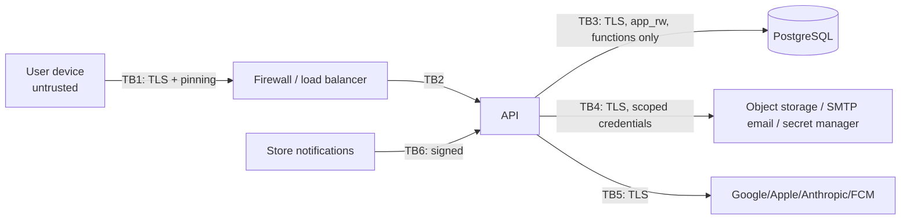

# 07 — Security Architecture

NaraaCare processes **personal health data** (weight, height, conditions/allergies, food, water, sleep, AI chats) for Indian users. Design baseline: **DPDP Act 2023 + DPDP Rules 2025**, OWASP ASVS L2, OWASP API Security Top 10 (2023), OWASP MASVS L1 + selected L2 controls. GDPR notes are in §10.

The security requirements in the brief are **acceptance criteria**. Session files reference them by the IDs below (SEC-x.y).

---

## 1. Assets and trust boundaries

| Asset | Classification | Where |
|---|---|---|
| Credentials (password hashes, OTPs, refresh tokens) | Secret | `auth.*` (hashed) |
| Identity PII (email, full name) | Personal | `auth.user_account.email_ct`, `app.user_profile.full_name_ct` (encrypted) |
| Health profile (sex, age, height, weight, target, goal, body type) | Personal – health | `app.user_profile` (database storage encryption + RLS) |
| Medical conditions / allergies | Personal – health, high | `medical_conditions_ct` (encrypted) |
| Logs (meals, water, sleep, workouts, temperature) | Personal – health | tracking schemas (database storage encryption + RLS) |
| Chat messages, Rin conversations, support text | Personal, may contain health | `*_ct` (encrypted) |
| Subscription state, purchase tokens | Financial | `billing.*` (tokens in plain text, §6.1) |
| Keys & secrets | Secret | hosting provider's secret manager (incl. the field-encryption master key) |

## 2. STRIDE threat model

| # | Threat | STRIDE | Component | Mitigations (control IDs) |
|---|---|---|---|---|
| T1 | Credential stuffing / brute force on login | S | `/auth/login` | Argon2id (SEC-1.1), lockout + backoff (SEC-1.6), per-IP/account rate limits (SEC-3.2), firewall bot rules, breached-password list |
| T2 | OTP guessing / replay | S | `/auth/otp/*` | 6 digits, 5 min, 3 attempts, single use, hashed, resend 30 s & 5/h (SEC-1.3) |
| T3 | Stolen refresh token reuse | S | `/auth/token/refresh` | rotation + family revocation on reuse (SEC-1.2), hashed at rest, bound to installation |
| T4 | Forged Google/Apple ID token | S | OAuth endpoints | verify signature with provider JWKS, `iss`, `aud` (our client IDs), `exp`, `nonce`, `email_verified` |
| T5 | Account takeover via social email match | S | OAuth link | no silent auto-link; password proof required (OQ-30) |
| T6 | IDOR/BOLA: reading another user's meals, circle, report | I/E | all object routes | user from JWT only; ownership check inside DB function; RLS on owned tables (SEC-1.5, SEC-4.4); 404 not 403 |
| T7 | Privilege escalation to staff APIs | E | `/admin/*` | role claim from DB at token issue, `require_role`, IP allow-list, audit (SEC-1.5) |
| T8 | Stored XSS / script in names, chats, food/drink names reaching the admin panel, emails, push, PDF | T/E | all text inputs | 3-layer no-markup validation (SEC-2), output encoding (SEC-2.5) |
| T9 | SQL injection | T/I | backend → DB | only bound parameters to fixed function names; no dynamic SQL; `format(%I,%L)` if ever needed (SEC-4.1) |
| T10 | Mass assignment (e.g. `role`, `tier`, `user_id` in body) | E | schemas | Pydantic `extra="forbid"`; explicit request models (SEC-3.1) |
| T11 | Tier bypass (patched app unlocks STAR) | E | premium routes | server entitlement checks; responses filtered (SEC-6.3) |
| T12 | Fake purchase / receipt replay | S/T | `/billing/purchases/verify` | server-side store verification, token → one user, idempotency, RTDN/ASSN signature checks (SEC-6.2) |
| T13 | Forged store webhook | S | webhooks | Google: Pub/Sub OIDC JWT verified (audience, SA email); Apple: JWS chain to Apple Root CA G3; unique notification id (SEC-6.2) |
| T14 | Data leak via logs / crash reports / analytics | I | logging, Sentry | redaction processor, no bodies, no PII/health values (SEC-7.4) |
| T15 | MITM on hostile Wi-Fi | I/T | app ↔ API | TLS 1.2+, HSTS, cert pinning, cleartext blocked (SEC-5.2) |
| T16 | Token theft from a lost/rooted device | I | app storage | Keychain/Keystore only, SQLCipher local DB, biometric lock option, root warning (SEC-5.1, 5.4, 5.6) |
| T17 | Shoulder-surfing / app switcher | I | app UI | app-switcher blur, FLAG_SECURE on sensitive screens (SEC-5.5) |
| T18 | Malicious deep link / invite token | T/E | `app_links` | validate scheme/host/path, parameters through validators, server resolves tokens (SEC-5.8) |
| T19 | DoS / resource exhaustion (large bodies, huge pages, report spam) | D | API, workers | body size limits, pagination caps, rate limits, job quotas, web application firewall (SEC-3.4) |
| T20 | Prompt injection via Rin / custom drink names | T/I | Rin AI | user text is data in a user turn; system prompt states it; tools restricted to server-validated proposals; no tool executes without user confirmation; outputs never rendered as HTML (doc 06 §8) |
| T21 | Malicious upload (polyglot image, huge image) | T/D | support ticket upload | magic-byte check, size ≤ 10 MB, decode + re-encode with Pillow (decompression-bomb limit), EXIF stripped, random object key, never served publicly |
| T22 | Insider access to health data | I | DB, admin | envelope-encrypted fields (keys outside the DB), least-privilege roles, staff access audited, no prod DB access without break-glass |
| T23 | Repudiation of consent / deletion | R | privacy | append-only consent records with policy version + timestamp; audit log (SEC-7.1) |
| T24 | Secret leakage in repo / binary | I | all repos | gitleaks pre-commit + CI, no secrets in app, secret manager (SEC-8.1) |
| T25 | Vulnerable dependency | T/E | all | pip-audit, `flutter pub outdated`, Dependabot, SAST (SEC-8.2/8.3) |
| T26 | Account enumeration | I | sign-up, forgot password | generic forgot-password response, rate limits (OQ-26) |
| T27 | Chat spam / harassment | D/I | circles | block, admin remove/delete, rate limit 30 msg/min |

## 3. Authentication and authorisation (SEC-1)

| ID | Control | Implementation |
|---|---|---|
| SEC-1.1 | Password hashing | **Argon2id** (`argon2-cffi`): memory 64 MiB, time 3, parallelism 2, 16-byte salt, 32-byte hash. Rehash on login when parameters change. Plain passwords are never logged (redaction processor + `SecretStr`). |
| SEC-1.2 | Tokens | Access JWT: EdDSA (Ed25519), 15 min, claims `sub, role, tier_hint, sid (family), iat, exp, iss, aud, jti`. Private key from the secret manager; `kid` header for rotation. Refresh token: 256-bit random, opaque, 60-day sliding expiry, stored as SHA-256; every refresh rotates. Presenting a used/revoked token **revokes the whole family**, raises a `refresh_reuse` security event and forces re-login. Refresh tokens are bound to the app installation (`installation_id`, stored in plain text). Access tokens are verified statelessly; logout puts the session on an in-memory deny-list in the API process and logout-all / password reset store a per-user cut-off (millisecond `iat_ms` claim), each for the 15-minute token lifetime (per API process and lost on restart; refresh tokens are revoked in the database regardless). Keys: `tools/new_jwt_key.py`; dev without keys uses an ephemeral key. |
| SEC-1.3 | OTP | `secrets.randbelow(10**6)` zero-padded; Argon2id hash (low cost: 16 MiB, t=2); 5-min expiry; 3 attempts then the challenge is dead; single use; resend cooldown 30 s, max 5/h/email; constant-time compare; codes never logged; email over SMTP with no other data (dev: written to an outbox folder, never logged). |
| SEC-1.4 | Social login | Both providers verified locally with PyJWT against the provider JWKS (cached 1 h, early refresh at most once a minute on an unknown `kid`): RS256 only, `iss` = provider, `aud` ∈ our client IDs (Google: Android/iOS/web; Apple: bundle/service ID), `exp`/`iat`, nonce = SHA-256(hex) of the raw nonce the app sends us, `email_verified` required to create or match an account. An email that already has a password account gets 409 `LINK_REQUIRED` with a 10-minute signed link token (provider subject + verified email); linking needs the password and counts towards lockout (OQ-30). Apple's `authorization_code` is exchanged server-side (ES256 client secret) for a refresh token, stored on the identity link for revocation on deletion (Apple requirement). |
| SEC-1.5 | Authorisation | Roles `user, nutritionist, support, admin` + circle roles. FastAPI dependencies: `current_user` (JWT), `require_role(...)`, `require_entitlement(feature)`, `require_username`. Object level: every DB function filters by `app.user_id` / checks membership; RLS on owned tables. Lookups by foreign IDs return 404. |
| SEC-1.6 | Logout & lockout | `/auth/logout` revokes the family; `/auth/logout-all` revokes all families. Password change/reset/deletion revoke all. Lockout: after 5 failures in 15 min the account is locked with exponential backoff (1, 5, 15, 60 min), and an email notice is sent. Per-IP limits stay independent so attackers cannot lock users out at scale without hitting IP limits. |

## 4. Input validation — no scripting in any input field (SEC-2)

### 4.1 Scope
Every user-entered string in the app and every string the API accepts: names, usernames, circle names, notes, chat, Rin prompts, food/drink names, feedback, search boxes, query parameters, path parameters, headers used as data (`X-Request-ID`, `Idempotency-Key`), file names, deep-link parameters, AI-generated text stored for display (validated again before storage).

### 4.2 Canonical reject patterns (shared by all three layers)
Input is **rejected (not stripped)** if, after normalisation, it matches any of:

| # | Pattern | Catches |
|---|---|---|
| R1 | `[<>]` | any HTML/XML tag (`<script>`, ``, `<svg>`, `<iframe>`, `<a>`, `</`) |
| R2 | `(?i)(^|[^a-z])on[a-z]+\s*=` | event handlers (`onerror=`, `onload=`, `ONCLICK =`) |
| R3 | `(?i)(javascript|vbscript|livescript)\s*:` and `(?i)data\s*:\s*[a-z]+/[a-z0-9.+-]+` | script/data URI schemes, incl. `java\tscript:` after whitespace removal check (R3b: same test on the string with all whitespace/control removed) |
| R4 | `\{\{|\}\}|\$\{|<%|%>|#\{` | template / expression syntax |
| R5 | `[\x00-\x08\x0B\x0C\x0E-\x1F\x7F​-‏‪-‮⁦-⁩]` | control chars, null bytes, zero-width and bidi overrides (newline `\n` allowed only in multi-line types) |
| R6 | `(?i)&#x?[0-9a-f]+;?|&[a-z]+;` (in the *raw* input) | HTML entities (obfuscation) |
| R7 | `(?i)%[0-9a-f]{2}` (in the raw input, for non-URL fields) | URL-encoding obfuscation |
| R8 | `(?i)\\u[0-9a-f]{4}|\\x[0-9a-f]{2}` | escaped Unicode/hex sequences |
| R9 | `(?i)expression\s*\(|url\s*\(|@import` | CSS injection |

Normalisation before checking: (1) reject R5 on the raw input; (2) Unicode **NFKC** (folds full-width `＜` to `<`, ligatures, etc.); (3) decode URL-encoding and HTML entities repeatedly (max 3 passes) **only to inspect**; if decoding changed the string, R6/R7 already rejected it; (4) apply R1–R9 to the normalised and decoded forms; (5) apply the per-type allow-list (doc 04 §1.2); (6) check length on the normalised value. The stored value is the NFKC-normalised original (which, having passed, contains no encodings).

### 4.3 Layer 1 — Flutter (UX, not the security boundary)
- `lib/core/security/input_validators.dart` — the only validator module. Functions: `name`, `username`, `email`, `password`, `passwordLogin`, `confirmPassword`, `otp`, `integer(min,max)`, `decimal(min,max,decimals)`, `shortText(max)`, `freeText(max)`, `chatMessage(max)`, `search`, `usernameSearch`, `barcodeOrSearch`. Each returns a localised error **code** (never the input).
- `NcTextField` (shared widget) **requires** a validator and `maxLength`; a lint rule (custom `analysis_options` + test that scans widgets) fails if a raw `TextFormField`/`TextField` is used outside `shared/widgets/nc_text_field.dart`.
- Allow-lists via `FilteringTextInputFormatter`: numbers `^\d*\.?\d{0,2}$`; OTP digits only (6); username `[a-z0-9._]` (auto-lower-case).
- Error copy: "Please use letters, numbers and basic punctuation only." Never echoes the input.
- Rendering: `Text`/`SelectableText` only; no WebView, no HTML widgets, no markdown rendering of user or AI text. Rin AI output is plain text; allowed formatting is limited to line breaks and "•" bullets produced by our own parser.
- Deep-link parameters (invite token, referral code) pass the same validators before use.

### 4.4 Layer 2 — Backend (authoritative)
- `app/core/security/validators.py` defines all `Safe*` types (doc 04 §1.2). Every request schema field of type string uses one; CI fails on a bare `str`. Path/query parameters use the same types (`Annotated[SafeSearchQuery, Query()]`).
- Pydantic `model_config = ConfigDict(extra="forbid", str_strip_whitespace=False, strict=True)` (no silent coercion).
- On rejection: `422 VALIDATION_FAILED`, "Input contains characters that are not allowed", field names only. Log `security_event(validation_rejected, user_id, field, request_id, route)` **without the payload**.
- Abuse: ≥ 10 rejections in 10 min per user or IP → that principal's rate limit tightens to 10 req/min for 15 min; ≥ 50 in 1 h → security alert (Sentry + monitoring alert).
- Headers used as data: `X-Request-ID` must be a UUID (else replaced); `Idempotency-Key` UUID; `User-Agent` is logged truncated to 200 chars and never stored in the DB.
- Rich text: none. Any future need requires a separate security approval and `nh3` with a minimal allow-list.
- *Implementation notes (S04):*
  - Passwords get R1-R9 too (no allow-list), after NFKC (NIST SP 800-63B normalisation).
  - Rejections are classified: `unsafe_input` (R1-R9: security event + penalty box) versus `invalid_format` (allow-list only, e.g. digits in a name: no event).
  - Path/query/header parameters must use `Annotated[SafeX, Query()]`. The default-value form `x: SafeX = Query()` makes FastAPI skip the validator; a Semgrep rule bans it and the OpenAPI-driven payload sweep would catch it.
  - Every Safe* field carries `x-safe-kind` in OpenAPI, and a test fails if any string field lacks it.
  - Third-party loggers that print URLs (`httpx2`, `httpcore`, `urllib3`, `uvicorn.access`) are capped at WARNING.

### 4.5 Layer 3 — PostgreSQL (defence in depth)
- Domain `common.safe_text` (doc 05 §4) on every text column + per-column `char_length` CHECK.
- Encrypted columns cannot be pattern-checked; the API validates before encrypting, and the DB checks ciphertext length bounds.
- Every procedure/function validates text parameters by casting to `common.safe_text` / `common.username` and `RAISE EXCEPTION USING ERRCODE = '22023'` (invalid_parameter_value), which the API maps to 422.

### 4.6 Output side (SEC-2.5)
| Channel | Rule |
|---|---|
| API | JSON only, `application/json; charset=utf-8`, `X-Content-Type-Options: nosniff` |
| Emails (SMTP) | fixed `string.Template` files whose values are allow-listed (codes and numbers only), so no user text can reach an email (S05; replaces Jinja2 auto-escaping) |
| Push notifications | plain text; user names/usernames are the only user strings, already validated; length-capped |
| PDF reports | ReportLab `Paragraph` text is XML-escaped (`xml.sax.saxutils.escape`) before use; no HTML-to-PDF engine |
| Admin tooling | any future admin web UI must use a framework with auto-escaping and a strict CSP (`default-src 'self'`) |
| CSV exports | prefix cells beginning with `= + - @` with `'` (formula-injection guard) |

### 4.7 Tests (SEC-2.6)
- Payload list `tests/security/payloads/xss.txt` (~300 entries): OWASP XSS filter-evasion cheat-sheet vectors, encoded variants (URL, double URL, HTML entity decimal/hex, `<`, full-width), mixed case, null bytes, zero-width, template payloads (`{{7*7}}`, `${7*7}`, `<%= %>`), SQLi strings, path traversal, CSV formula payloads. Header line `# payload-list-version: X.Y.Z`; the same file (same version) is copied into the mobile and database repos.
- Backend: a parametrised test iterates **every route × every string field** (discovered from the OpenAPI schema) × every payload → asserts 422 and that no security-event log contains the payload.
- Flutter: a widget test per form asserts each `NcTextField` validator rejects every payload.
- DB: a pgTAP test inserts every payload into every `safe_text` column via the procedures → asserts an exception.

## 5. API security (SEC-3, OWASP API Top 10 2023)

| OWASP | Control |
|---|---|
| API1 BOLA | SEC-1.5, RLS, ownership in functions; automated IDOR tests with two users |
| API2 Broken auth | SEC-1.x |
| API3 Object property level | response models are explicit (no `dict` passthrough); `extra="forbid"` on input; tier-filtered fields |
| API4 Resource consumption | body limits (1 MB / 10 MB upload), pagination max 50, array caps, rate limits, report/export quotas, Rin token allowance, worker timeouts |
| API5 Function level auth | `/admin/*` role + IP allow-list; webhooks verified |
| API6 Sensitive business flows | sign-up/OTP/referral/purchase limits; referral anti-fraud |
| API7 SSRF | the server never fetches user-supplied URLs; outbound allow-list (Google, Apple, Anthropic, FCM, OFF, email and storage endpoints) via egress firewall rules/proxy |
| API8 Misconfiguration | security headers, docs disabled in prod, uniform errors, TLS-only, CORS allow-list |
| API9 Inventory | versioned `/api/v1`, OpenAPI checked into repo, deprecated endpoints listed |
| API10 Unsafe consumption | store/Google/Apple/LLM responses validated with Pydantic before use |

Rate limits (Redis sliding window; keys = user id, else IP): global 300/min/user, 600/min/IP; auth routes as in doc 04; writes 60/min/user; search 30/min.
Security headers on every response, including 4xx/5xx: `Strict-Transport-Security: max-age=63072000; includeSubDomains; preload`, `X-Content-Type-Options: nosniff`, `X-Frame-Options: DENY`, `Referrer-Policy: no-referrer`, `Content-Security-Policy: default-src 'none'; frame-ancestors 'none'`, `Cache-Control: no-store` (except `/reference/*`), `Permissions-Policy: accelerometer=(), camera=(), geolocation=(), gyroscope=(), magnetometer=(), microphone=(), payment=(), usb=()`. Remove `Server` header. *(S04: "`()`" was not valid Permissions-Policy syntax. The docs pages (dev/staging only, behind basic auth on staging) get a CSP that allows the Swagger UI script.)*
CORS: mobile clients send no `Origin`; the allow-list is empty in prod (staging: internal tools only).

## 6. Database security (SEC-4)

| ID | Control |
|---|---|
| SEC-4.1 | Only parameterised calls: repositories run `SELECT * FROM schema.fn($1, $2)` / `CALL schema.pr($1, …)`. Function names are constants. A Semgrep rule bans f-strings/`%`/`.format` near `execute(`. Inside PL/pgSQL there is no `EXECUTE` of concatenated strings; partition DDL in `ops` uses `format('%I')`. |
| SEC-4.2 | Roles per doc 05 §7; the app never connects as owner/superuser; `REVOKE ... FROM PUBLIC`. |
| SEC-4.3 | `SECURITY DEFINER` functions: owner `api_definer`, `SET search_path = pg_catalog, pg_temp`, all names schema-qualified, `REVOKE EXECUTE ... FROM PUBLIC`, explicit `GRANT EXECUTE ... TO app_rw`. |
| SEC-4.4 | RLS enabled on user-owned tables with policies for `api_definer` (owner of all API functions); `app.user_id` set per transaction via `set_config('app.user_id', $1, true)`. Not *forced*, so owner-run maintenance (retention, deletion, partitions) still works (doc 05 §7). |
| SEC-4.5 | No field encryption (§6.1, owner decision 2026-11-03). Managed-database storage encryption at rest; encrypted backups. |
| SEC-4.6 | TLS required: the managed database rejects non-TLS connections; clients use `sslmode=verify-full` with the provider's CA bundle (the API refuses to start otherwise outside dev). |
| SEC-4.7 | Audit triggers on: `auth.user_account`, `app.user_profile`, `billing.subscription`, `billing.entitlement_grant`, `privacy.*`, `social.circle_member`, `nutrition.food_item`, `ref.*`. Actor = `app.user_id`, `request_id` = `app.request_id`. Columns ending `_hash` (passwords, refresh tokens) are stored as `[redacted]`; UPDATE rows keep only changed columns. The trigger is `SECURITY DEFINER` (owner `migration_owner`), and the API role has no privilege on the audit tables beyond inserting security events, whose `details` may hold only numbers, booleans and codes (never user text). |
| SEC-4.8 | Automated backups: PITR 35 days + daily backups copied to a second Indian region, encrypted with a separate key; monthly **restore drill** (doc 11). |

### 6.1 Plain-text storage (owner decision, 2026-11-03)
- **Decision:** user data is stored in plain text so the owner can read it while debugging. This replaces the field-level encryption and blind indexes designed on 2026-10-29 (no database had been deployed, so the baseline migrations were regenerated).
- **Hashed:** passwords (Argon2id, verified in the API) and refresh tokens (SHA-256). The owner chose to keep refresh tokens hashed, because a database copy would otherwise let anyone sign in as any user for up to 60 days.
- **Plain text:** email, OTP codes (compared in constant time), full name, medical condition codes, installation ids, IP addresses (`inet`), FCM push tokens, Play purchase tokens and the Apple refresh token. Later sessions follow the same rule for chat, Rin and support text.
- **Still enforced:** every text column uses a validating domain (`common.email`, `common.otp_code`, `common.opaque_token`, `common.safe_text`, ...), so markup and scripting are rejected in the database as well as the API. Other controls also still apply: RLS, least privilege, TLS, storage encryption at rest and encrypted backups.
- **Trade-off (security):** a database or backup leak now exposes emails, names, health conditions and store/push tokens directly. Access to the database, its backups and the read-only roles must be limited to named people; revisit before launch (OQ-74).

## 7. Mobile security (SEC-5, OWASP MASVS)

| ID | Control | Implementation |
|---|---|---|
| SEC-5.1 | Token storage | `flutter_secure_storage` (iOS Keychain `first_unlock_this_device`, Android Keystore-backed encrypted storage). Never `SharedPreferences`/files. The local DB key is also stored there. |
| SEC-5.2 | Transport | HTTPS/WSS only. Android `network_security_config.xml`: `cleartextTrafficPermitted="false"`, no user CAs in release. iOS ATS on, no exceptions. **Pinning**: dio `IOHttpClientAdapter.validateCertificate` checks the SPKI SHA-256 of the server's **leaf** certificate against `CERT_PINS` (current + backup key), plus normal chain validation, on every connection (not only on chain errors); pin rotation is planned with a 60-day overlap. *Deviation (S06, OQ-66):* `dart:io` exposes only the leaf certificate, so intermediate pins are not possible without a native plugin; certificate renewals must reuse the pinned key or ship the next key's pin first. Debug builds alone allow cleartext to `10.0.2.2`/`localhost` for a local backend. |
| SEC-5.3 | Release hardening | `flutter build --release --obfuscate --split-debug-info=build/symbols` (symbols uploaded to Sentry, not shipped); R8/ProGuard on; `debugPrint` stripped via a logger that is a no-op in release; `android:allowBackup="false"`, `android:debuggable` false. |
| SEC-5.4 | Root/jailbreak | warn-only banner (OQ-49); biometric lock still offered. Optional Play Integrity / App Attest server checks in S16. |
| SEC-5.5 | Screen privacy | app-switcher blur overlay on all screens; `FLAG_SECURE` / secure overlay on auth, OTP, password, account, deletion, export screens (OQ-50). |
| SEC-5.6 | Biometric lock | optional `local_auth` gate on app resume (> 60 s background), falls back to device passcode. |
| SEC-5.7 | No secrets in app | only non-secret config via `--dart-define-from-file`. Google/Firebase/Sentry identifiers are public by design, restricted by package name + SHA-256 signing cert / bundle ID in their consoles. |
| SEC-5.8 | Deep links | Android App Links (`assetlinks.json`) + iOS Universal Links (`apple-app-site-association`) on `REFERRAL_LINK_DOMAIN`; router accepts only `/invite/{code}` and `/circle/{token}`; parameters validated; the server resolves tokens. |
| SEC-5.9 | Local data | drift + SQLCipher (AES-256); cache limited to 14 days of own data; wiped on logout and on account deletion. |
| SEC-5.10 | Clipboard/keyboard | password fields `enableSuggestions:false, autocorrect:false`; OTP uses `AutofillHints.oneTimeCode`. |

## 8. Payments (SEC-6)

| ID | Control |
|---|---|
| SEC-6.1 | Google Play Billing / Apple StoreKit 2 via `in_app_purchase`; no custom card/UPI collection (OQ-07). |
| SEC-6.2 | Backend verification only. Android: Play Developer API `purchases.subscriptionsv2.get` with a service account (key in the secret manager), then acknowledge within 3 days. iOS: verify the signed transaction (JWS) with `app-store-server-library` against Apple root certificates, then confirm with App Store Server API `Get Transaction Info`. Purchase token / original transaction id is bound to one user (UQ); attempts to reuse it for another account are rejected and logged. RTDN (Pub/Sub push, OIDC-verified) and App Store Server Notifications v2 (JWS-verified) update status; a nightly reconcile job re-checks active subscriptions near expiry. |
| SEC-6.3 | Premium features gated in API (doc 04 §3); UI hiding is cosmetic. |

## 9. Privacy and compliance (SEC-7)

| ID | Requirement | Implementation |
|---|---|---|
| SEC-7.1 | Explicit, granular consent | Purposes: `terms`, `privacy`, `health_data` (required to use tracking), `ai_processing` (Rin, drink estimate; optional), `circle_sharing` (asked when first sharing), `marketing` (optional, off). Each record stores purpose, granted, policy version, timestamp, app version, hashed IP. Withdrawal is as easy as granting (Settings → Privacy). OS permissions (microphone, camera, notifications) are requested just-in-time with an explanation screen. |
| SEC-7.2 | Export & erasure | `POST /privacy/exports` (ZIP of JSON+CSV, 15-min signed link, file expires in 7 days). `POST /privacy/deletion-request` → status `pending_deletion`, sessions revoked, 30-day grace (cancel by signing in), then worker `pr_delete_user` hard-deletes personal data across schemas, removes stored files, revokes Apple tokens, deletes FCM tokens, anonymises billing/consent rows required by law, and writes a deletion receipt. |
| SEC-7.3 | Data minimisation | no mobile number, no DOB, no location, no contacts; age instead of DOB; only own data sent to the AI. |
| SEC-7.4 | No PII/health in logs, analytics, crash reports | structlog processor drops keys matching `password|token|otp|email|name|weight|height|kcal|ml|body|content|description|code` and bodies; Sentry `send_default_pii=False` + `before_send` scrubber (both app and API); no third-party analytics in MVP. |
| SEC-7.5 | Retention | per table (doc 05 §9), enforced by `ops.pr_apply_retention` + object-storage lifecycle rules. |
| SEC-7.6 | Medical disclaimer | doc 01 §7 copies; shown in Info screens, Rin help, reports, onboarding result page. |
| DPDP specifics | Notice in plain language (English; Hindi later) itemising data and purposes; Grievance Officer contact in Help & Support; breach notification to the Data Protection Board and affected users per DPDP Rules timelines (runbook in doc 11); a Significant Data Fiduciary assessment is not expected at MVP scale (re-evaluate); processors (the hosting provider, the email provider, Anthropic, Google/Firebase, Sentry) under DPAs; cross-border transfers are only to non-restricted countries. |

## 10. GDPR delta (only if EU users are added — OQ-54)
Lawful basis = explicit consent (Art. 9 special-category health data); DPIA required; EU representative (Art. 27); SCCs for transfers to India/US; a data subject rights SLA of 30 days; the age of digital consent stays 18 (stricter than GDPR); Sentry/Anthropic data processing addenda; cookie rules don't apply to the native app, but analytics SDKs would need consent.

## 11. DevSecOps (SEC-8)

| ID | Control | Tool |
|---|---|---|
| SEC-8.1 | Secret scanning | `gitleaks` 8.30.1 pre-commit + CI on every PR (full history on main) |
| SEC-8.2 | Dependency scanning | `pip-audit` (backend), `flutter pub outdated` + OSV-Scanner (mobile), Dependabot (all repos, weekly) |
| SEC-8.3 | SAST | Bandit + Semgrep (`p/python`, `p/owasp-top-ten`, custom rules: no bare `str` in schemas, no SQL string building, no `print`) ; Semgrep for Dart; `dart analyze` with very_good_analysis |
| SEC-8.4 | Lint/format | ruff (lint + format; replaces black) + mypy strict (Python); `dart format` + `flutter analyze` (Dart); sqlfluff (postgres dialect) |
| SEC-8.5 | Security tests | `tests/security/`: auth bypass, IDOR (two-user fixtures), injection, XSS payload sweep, rate limits, webhook forgery, token reuse |
| SEC-8.6 | Runtime | no containers: plain Python app installed with `uv sync --frozen --no-dev` (hash-checked lockfile, no dev tools), run as an unprivileged user with a read-only application directory, `--no-server-header --no-access-log`; CI checks it starts that way |
| SEC-8.7 | DAST | OWASP ZAP baseline + Schemathesis against staging nightly |
| SEC-8.8 | Branch protection | required reviews (2 for `security/`, `auth`, `billing`, migrations), required checks, signed commits, no force-push to main |
